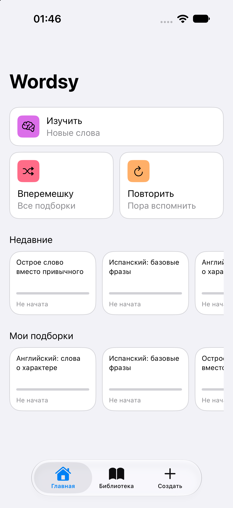
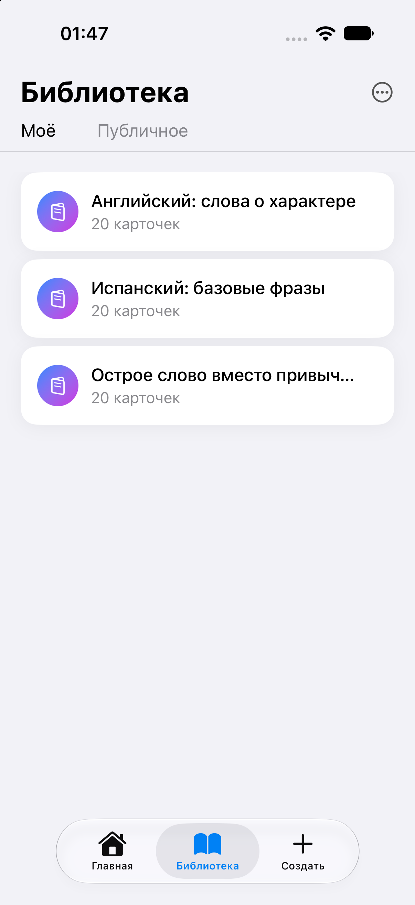
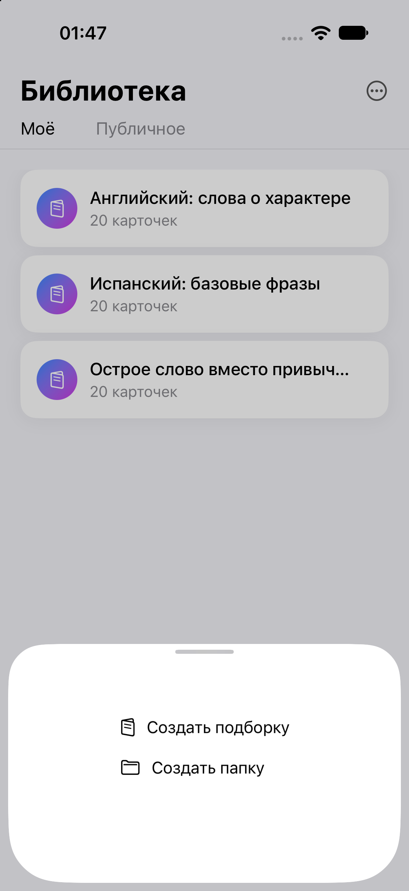
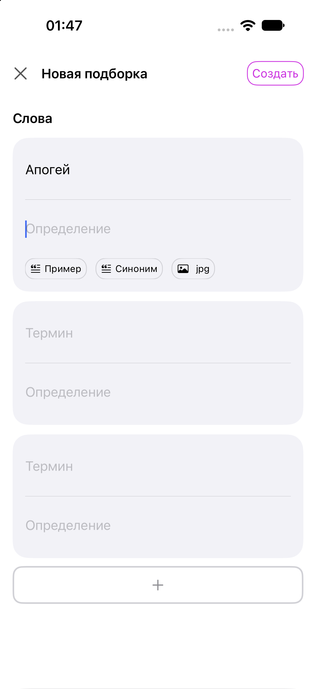
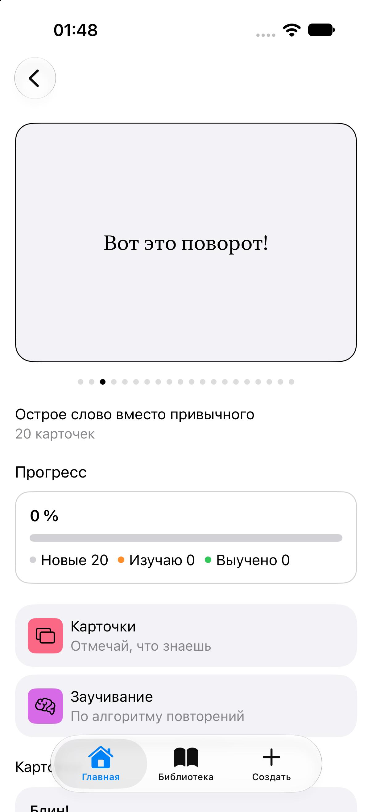
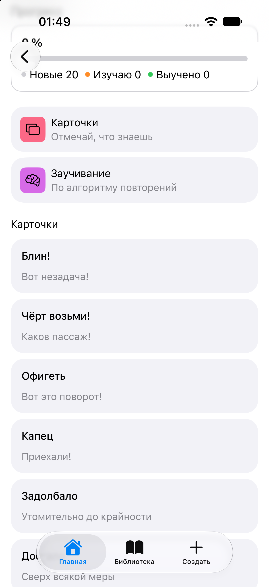
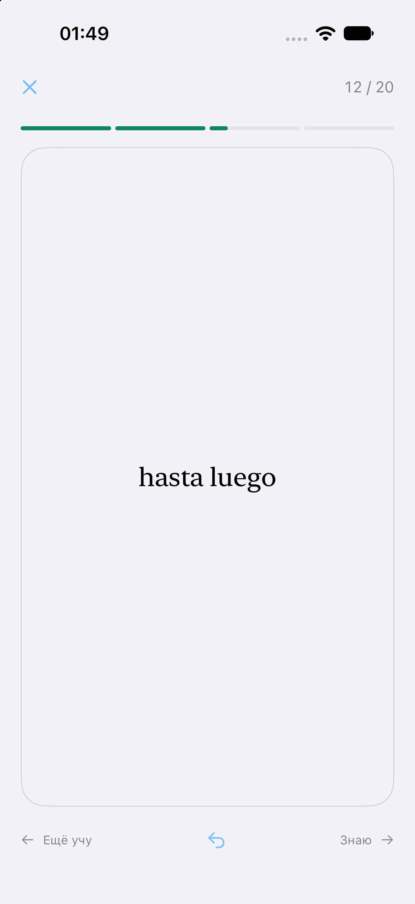
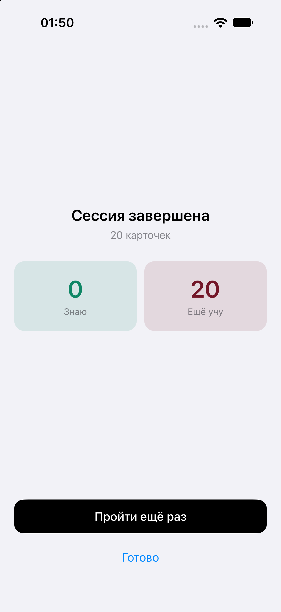

# Wordsy

**Говори то, что имеешь в виду.**

Wordsy — iOS-приложение для тех, кто хочет говорить и писать точнее. Это не просто карточки со словами: приложение помогает расширять словарный запас и находить точные слова и лексические конструкции для своих мыслей. Точный язык делает точнее и мышление.

Изучение иностранного языка — один из режимов, а не единственная цель. Wordsy подходит:

- тем, кто учит иностранные языки;
- тем, кто готовится к экзаменам;
- специалистам, которым важно уверенно владеть профессиональной терминологией;
- всем, кто хочет развивать словарный запас и речь на родном и иностранных языках.

  
  
  
  

  
  
  
  

## Что уже работает

- **Папки и колоды.** Слова можно группировать по темам: язык, экзамен, профессиональная сфера.
- **Карточки.** Добавление слов со значением или переводом.
- **Режим изучения.** Карточки показываются по очереди; можно отметить, знаешь ли ты слово.
- **Итоги тренировки.** Сколько слов уже знаешь, а сколько нужно повторить.
- **Главный экран** с быстрым доступом к колодам и библиотека всех наборов.

## Планы

- Режимы под разные цели.
- Упражнения на употребление слов в контексте.
- Интервальные повторения: слово возвращается, когда его пора освежить.
- Объяснения и примеры употребления с помощью ИИ.

## Технологии

- Swift, SwiftUI
- Архитектура: MVVM, внедрение зависимостей через DI-контейнер

## Статус

Ранняя версия. Основной сценарий работает, развитие приостановлено.

## Запуск

Открыть `Wordsy.xcodeproj` в Xcode и запустить на симуляторе (iOS 17+).

